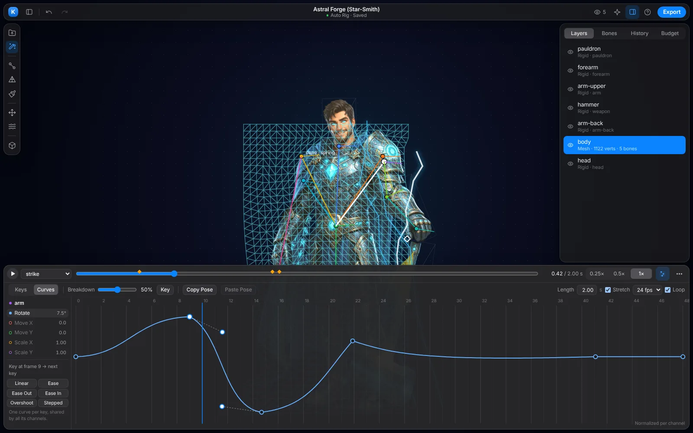
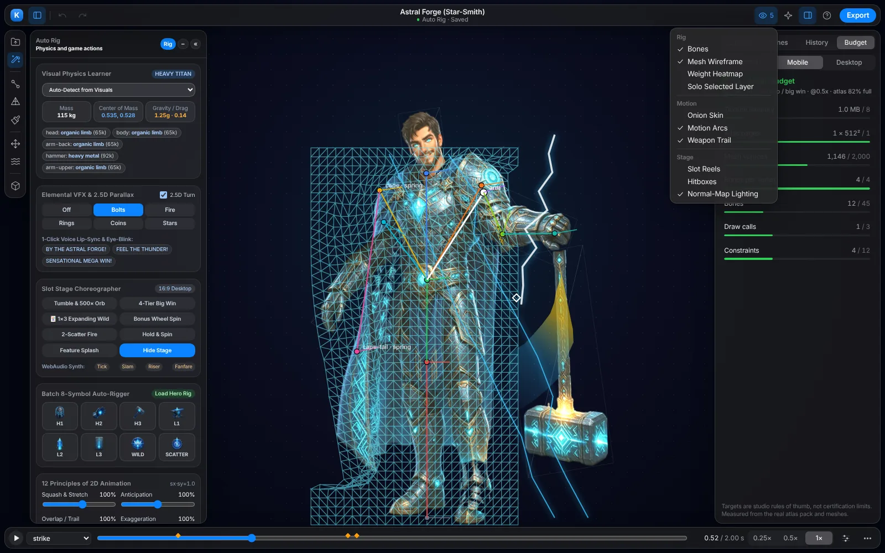
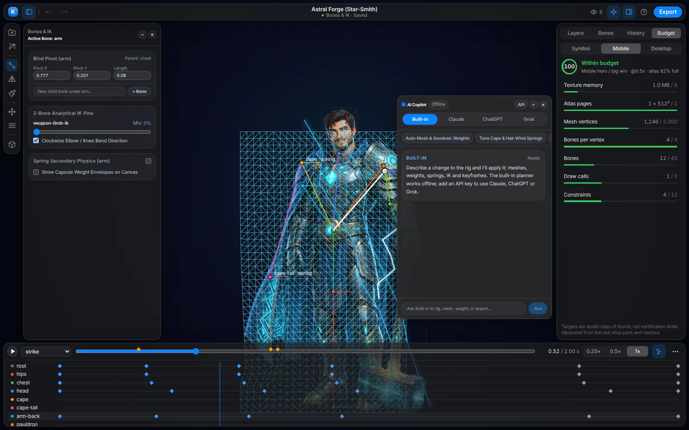
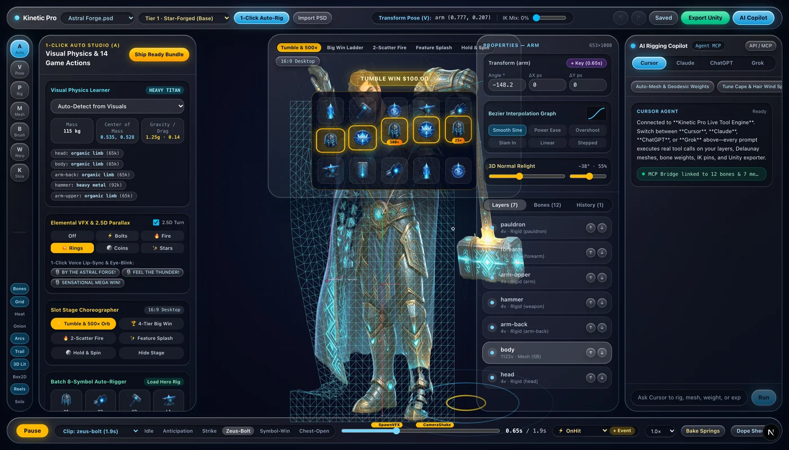
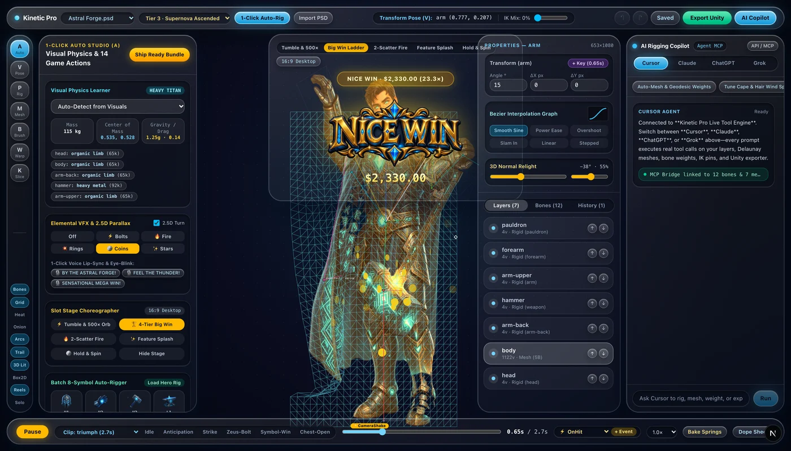
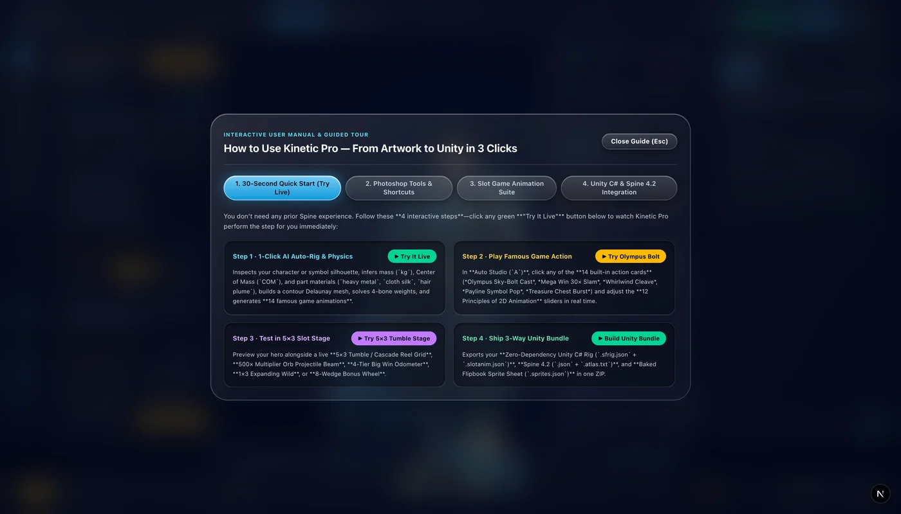

# Kinetic Pro — Apple Metal 2D Mesh, Rigging & Slot Game Animation Suite for Unity

**Kinetic Pro** is a standalone 2D skeletal, contour Delaunay mesh, weight-painting, and slot game animation studio built with **Apple Metal GPU acceleration (`Kinetic Pro.app`)**, a macOS pro-app style workspace, an **AI Rigging Copilot (offline planner, Claude, ChatGPT or Grok)**, and a **3-Way Unity & Spine 4.2 Export Engine**.

📖 **[Read the Complete User Manual (`USER_MANUAL.md`)](./USER_MANUAL.md)**













---

## Core Capabilities

1. **1-Click Auto Studio (`A`) & Visual Physics Learner**
   - Inspects character/symbol silhouette geometry, aspect ratio, and part layout to automatically infer **Mass (`kg`)**, **Center of Mass (`COM`)**, **Gravity/Drag**, and per-part material types (`heavy_metal`, `cloth_silk`, `hair_plume`, `organic_limb`, `crystal_energy`, `gold_medallion`), configuring real-time spring stiffness, damping, wind sway, and `follow` inertia.
   - **Apple Vision Pose Detection (`VNDetectHumanBodyPoseRequest`)** on macOS for automatic anatomical bone placement.

2. **12 Principles of 2D Animation Engine & 14 Built-In Famous Game Actions**
   - Live dials for **Volume-Preserving Squash & Stretch** ($s_x \cdot s_y \approx 1.0$), **Anticipation**, **Follow-Through & Overlapping Action**, and **Exaggeration**.
   - **14 Built-in Animations**: `idle`, `anticipation`, `cheer` (15×), `strike` (30×), `power` (45×), `triumph` (60×), `bow`, `zeus-bolt` (Olympus Sky Cast), `berserk-spin` (Whirlwind Cleave), `hit-react`, `symbol-win`, `wild-expand`, `scatter-trigger`, and `chest-open`.

3. **Slot Game Animation Suite (`src/core/slot-animation-suite.ts`)**
   - **Tumble / Cascade & `500×` Multiplier Orb Beam**: 4-phase column-staggered gravity drop, payline pop, shatter, and multiplier projectile beam into the top plaque.
   - **4-Tier Big Win Escalation & Live Odometer**: Choreographs `NICE` → `MEGA` → `SUPERB` → `SENSATIONAL` banners with rolling payout counter and coin fountain.
   - **1×3 Expanding Wild Reel Unfurl**, **Interactive 8-Wedge Bonus Wheel of Fortune** (with clapper pin spring physics), **2-Scatter Reel Fire**, **Hold & Spin Coins**, **Batch 8-Symbol Auto-Rigger**, **Dual 16:9 / 9:16 Safe Zones**, and **WebAudio Procedural Sound FX Synthesizer**.

4. **Contour Delaunay Mesher, GPU Weight Painter & Liquify FFD (`W`)**
   - Alpha-silhouette marching contour tracer + Ramer-Douglas-Peucker simplifier + Steiner crease vertices + Delaunay triangulation.
   - **Apple Metal Compute Kernel (`compute_auto_weights`)** & WebGL2 4-bone Linear Blend Skinning, interactive Weight Brush (`B`), Liquify FFD vertex sculpt (`W`), Onion Skinning, Motion Arcs, Weapon Slash Trails, and 3D Normal-Map Point Relighting.

5. **Triple Unity & Spine 4.2 Export Pipeline + Zero-Dependency Unity C# Runtime (`com.spineforge.runtime`)**
   - **Zero-Dependency Unity Runtime**: Exports `<id>.sfrig.json` + `<id>.slotanim.json` + `<id>.png` with `SpineForgeAnimator.cs` (`MeshFilter`/`MeshRenderer`, 4-bone LBS, `PolygonCollider2D` hitboxes, multi-skins, and `OnAnimationEvent` triggers)—no Spine license required.
   - **Spine 4.2 Standard**: Exports `<id>.spine.json` + `<id>.atlas.txt` + `<id>.png`. By default the export is **native**: authored easing curves are kept, spring bones become Spine 4.2 **physics constraints**, follow bones become **transform constraints**, and IK mix keys become IK timelines, so the file stays editable in Spine. Pass `physics: "bake"` to sample everything into plain keys for pre-4.2 runtimes. Every build is round-tripped through Esoteric's official `spine-core` 4.2 runtime in the test suite.

6. **Performance Budget (Inspector → Budget)**
   - Measures the real atlas pack, texture memory, mesh vertices, bones per vertex, draw-call breaks and constraint count against Symbol / Mobile / Desktop targets, with one-line advice for anything over. Targets are studio rules of thumb; adjust them in `src/core/budget.ts`.
   - **Baked Flipbook Sprite Sheet & Transparent `.WebM` Video**: Bakes multi-clip sprite sheets (`<id>-sheet.png` + `<id>.sprites.json`) on the Apple Metal GPU in ~200ms.

---

## Quick Start

```bash
# 1. Launch the native macOS app (from the repo folder)
open "Kinetic Pro.app"

# 2. Start the web studio on http://127.0.0.1:3460 (bound to this machine only)
npm run dev

# 3. Run Unit Tests & Unity C# Runtime Verification
npm run verify:all

# 4. Export All Presets via CLI
npm run export:cli -- all
```

### AI Copilot keys and models

The copilot works offline with its built-in planner. To use a cloud model, paste a key in the copilot's **API** drawer or set `ANTHROPIC_API_KEY`, `OPENAI_API_KEY` or `XAI_API_KEY`. Default models are `claude-sonnet-5-5`, `gpt-5-mini` and `grok-4`; override them with `KINETIC_CLAUDE_MODEL`, `KINETIC_OPENAI_MODEL` or `KINETIC_XAI_MODEL`. If a cloud call fails, the reply says why and falls back to the built-in planner.

### Keyboard

| Key | Action | Key | Action |
| --- | --- | --- | --- |
| O | Import | Space | Play / pause |
| A | Auto rig | ← → | Step one frame |
| P | Bones & IK | K | Keyframe sheet |
| M | Mesh | I | Inspector |
| B | Weight paint (`[` `]` brush size) | C | Copilot |
| V | Pose | Tab | Hide all panels |
| W | Warp | ⌘Z / ⇧⌘Z | Undo / redo (100 steps) |
| E / ⌘E | Export | ⌘S | Save |
| S / ⇧S | Key selected bone / all bones | , . | Previous / next key |
| G | Graph editor | ⌘C / ⌘V | Copy / paste pose |
| Delete | Delete selected key | ⌥-click key | Delete key |

### Animation tools

- **Graph editor (G)**: rotation, move and scale curves per bone with bezier handles, frame-snapped key dragging (⇧ locks an axis) and curve presets. One curve per key, shared by its channels.
- **Dope sheet (K)**: drag keys to retime on whole frames, click to jump, ⌥-click or Delete to remove.
- **Breakdown**: key every bone (⇧ selected bone) at any percentage between its neighbouring poses, including overshoot.
- **Pose clipboard**: ⌘C copies the full pose at the playhead, ⌘V pastes it as one undo step.
- **Clip timing**: length (optionally stretching keys and events), 24/30/60 fps, loop.
- Every drag is one undo step. Unity export bakes each clip at its own frame rate (at least 30 Hz) so short, snappy timing survives.
